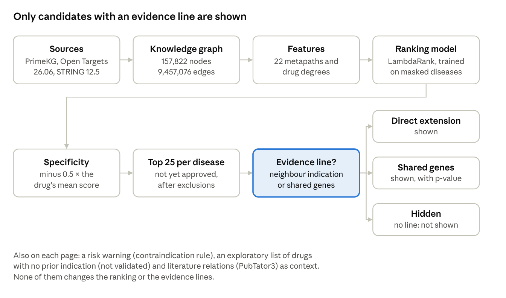
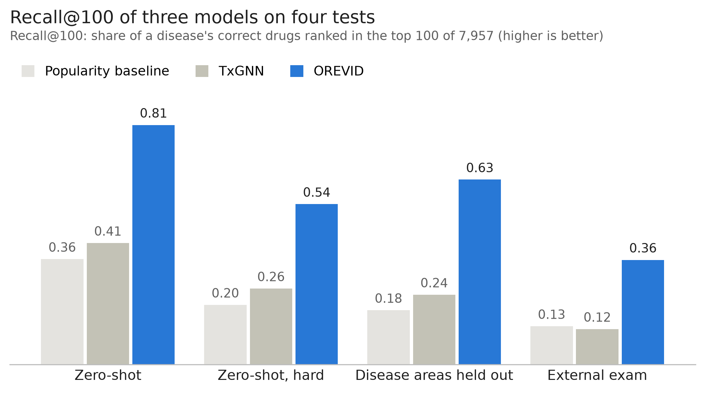
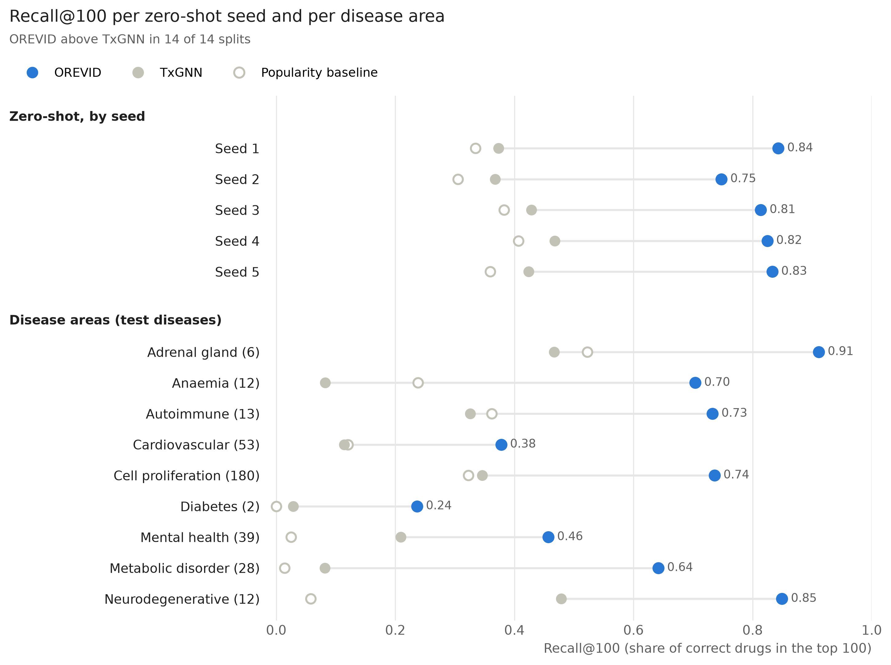
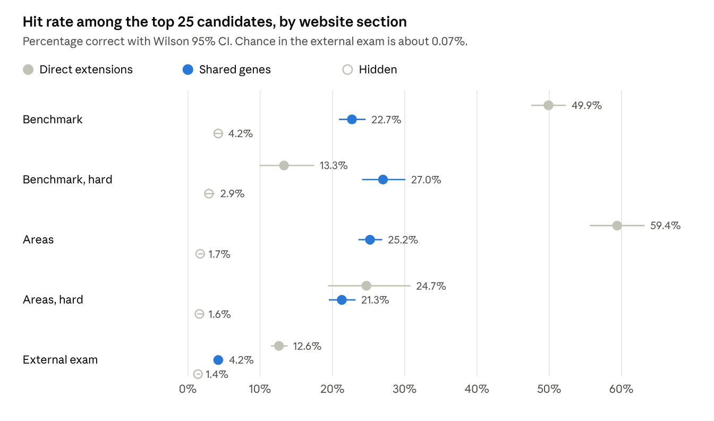

<!-- Draft preprint (bioRxiv), 12 October 2026. Source of truth: the Claude Docs document (see docs/STATUS.md); this file and OREVID_preprint_draft.docx are exports of it. -->

# OREVID: open, evidence-based drug repurposing with a benchmark against TxGNN

**Joaquim Quadrada**, independent researcher, Barcelona, Spain. Correspondence: contact@orevid.org

## Abstract

**Background.** Knowledge-graph models can rank existing drugs for a disease, but their benchmarks mostly reward rediscovering known treatments, and their scores rarely come with evidence a researcher can check. We built OREVID, an open tool that shows a ranked candidate only when an evidence line supports it and reports how often each line was right on held-out data, and compared it with TxGNN on identical data.

**Methods.** The graph combines PrimeKG, Open Targets, STRING and PubTator3 (157,822 nodes, 9.46 million edges). For each disease, 22 degree-weighted metapath features feed a LightGBM LambdaRank model trained with masked neighbourhoods. A candidate is shown only if it is indicated for an ontology-neighbour disease or for a disease sharing at least 3 associated genes (hypergeometric p < 10⁻⁶). The acceptance criteria for these rules were set in advance; the rules were revised on the hidden-treatment benchmarks and then measured on an external set of approvals not used to choose them. TxGNN was retrained with its official code on the same PrimeKG splits, and all tasks and predictions are released as OREVID-bench.

**Results.** Zero-shot Recall@100 (mean ± SD over five splits) was 0.811 ± 0.042 for OREVID, 0.412 ± 0.042 for TxGNN and 0.358 ± 0.040 for a popularity baseline, with OREVID ahead on every split (paired difference with TxGNN 0.399, 95% CI 0.352–0.443, resampling diseases). On nine disease areas held out it was 0.617 against 0.237, ahead in all nine, although TxGNN had the higher AUPRC in five. Training OREVID without validation labels and excluding diseases where TxGNN outputs constant scores gave 0.809 against 0.421. On 3,718 approvals absent from PrimeKG, Recall@100 was 0.359 against 0.121, and 0.178 against 0.085 for the 2,719 approvals not obvious from the disease ontology; a logistic regression on the same features without the drug-popularity feature performed similarly. Of the candidates the website's rules select in this external exam, 12.6% (95% CI 11.5–13.8%) of direct extensions and 4.2% (3.6–4.9%) of shared-genes candidates were among the unseen approvals, against about 0.07% by chance. A drug acting on a disease gene, with no other evidence, was right 1.8–3.4% of the time, no better than candidates with no evidence line at all.

**Conclusions.** Reporting the hit rate of each evidence line makes repurposing predictions checkable and shows how low their precision is on approved uses missing from the training graph. Most of the signal comes from what already works in related diseases. OREVID is a hypothesis generator, not a clinical tool; code, data and benchmark are public (https://orevid.org, doi:10.5281/zenodo.23323226).

## Introduction

Repurposing approved or investigational drugs for new diseases can shorten development, because safety and manufacturing are already known \[1\]. Computational approaches rank candidate drug–disease pairs from heterogeneous biomedical data; knowledge graphs that link drugs, genes, diseases and phenotypes are a common substrate, from metapath-based models such as Project Rephetio \[2\] to graph neural networks such as TxGNN, trained on the PrimeKG graph \[3,4\].

Other families of methods have been applied to the same task. Knowledge-graph embeddings such as TransE, ComplEx and RotatE \[5–7\] score triples from learned vectors, but on biomedical graphs their predictions are biased towards high-degree nodes, which favours well-studied drugs \[8\]. DREAMwalk extends guilt-by-association with random walks across several layers of a biomedical graph \[9\], and KGML-xDTD combines graph learning with paths found by reinforcement learning that explain each prediction \[10\]. The ranking model used here is closest to Rephetio's degree-weighted path counts \[2\]; it differs in training a ranking objective under masked disease neighbourhoods, and in deciding what to display from evidence lines whose hit rates are reported.

Two problems limit how much such predictions can be trusted. First, standard evaluations hide some known indications and check whether the model recovers them. This rewards rediscovery: many held-out diseases have a near-identical neighbour in the ontology with the same drugs, and drugs with many indications score well everywhere. Second, most tools return a score per pair without the evidence behind it, and without saying how often that kind of evidence turns out to be right.

OREVID addresses both. It ranks drugs with an interpretable metapath model, but shows a candidate only when one of a few evidence lines supports it, and reports each line's hit rate on held-out splits and on an external set of approvals that was not used to choose the rules. We report the usual hidden-treatment tests next to this stricter external exam, and we reran TxGNN with its official code on the same data so that the comparison is direct. Tasks, predictions and code are released as a public benchmark, OREVID-bench.

## Methods

**Figure 1.** From the sources to a disease page. The model ranks every drug; only the 25 highest-ranked candidates not yet approved are considered, and each is shown only if one of two evidence lines supports it.

### Knowledge graph

The graph merges PrimeKG \[4\] (Harvard Dataverse, doi:10.7910/DVN/IXA7BM), which aggregates DrugBank \[11\], SIDER \[12\], DisGeNET \[13\], MONDO \[14\] and other sources, with Open Targets Platform release 26.06 \[15\] (drug mechanisms with direction from ChEMBL \[16\], clinical stage and year per drug–disease pair, trials stopped for efficacy or safety, gene–disease evidence by type) and STRING 12.5 \[17\] (interactions with confidence ≥ 700). The result has 157,822 nodes and 9,457,076 undirected edges. Relations mined from the literature with PubTator3 \[18\] are shown to users as context but never enter features or evaluation, because «drug treats disease» is the answer being predicted. Release 26.06 of Open Targets was used because in 26.09 multiple sclerosis was merged into a measurement term; the issue was reported upstream. Supplementary Table S1 lists which relations are model features and which are only displayed.

### Features and ranking model

For each disease, 22 metapath scores are computed for every drug (Supplementary Table S2), for example *drug targets a disease gene*, *drug is indicated for a disease sharing genes* or *drug is indicated for an ontology neighbour*. Paths are counted on degree-normalised adjacency matrices (D⁻⁰·⁵ M D⁻⁰·⁵), so that hub nodes weigh less, as in degree-weighted path counts \[2\]. The drug's number of indications in the training graph (popularity) and its degrees in five other relations (targets, side effects, drug interactions, contraindications and off-label uses) are added as features. Apart from the training indications, contraindications and off-label uses, no drug–disease relation enters the features: trials, literature-mined relations and Open Targets clinical evidence are excluded, because an equivalent but unmapped disease could carry the answer into the graph.

A LightGBM LambdaRank model \[19,20\] (300 trees, learning rate 0.05, 31 leaves, at least 50 rows per leaf, L2 regularisation 1) learns to order drugs within each disease from 1,500 training diseases (all positives, 10% of negatives). To train under test-like conditions, five additional rounds each pick 40 seed diseases, hide their neighbourhoods (diseases up to two ontology steps away or with a gene-set Jaccard similarity ≥ 0.5; neighbourhoods of more than 400 diseases are skipped) and add those diseases as training groups. Test diseases never enter training. For display, scores are standardised per disease and reduced by 0.5 times the drug's mean standardised score over 2,000 reference diseases, which removes drugs that rank high everywhere at a cost of about 0.01 in Recall@100. For comparison, a class-balanced logistic regression on the same metapath features, without the popularity feature, was trained on the same rows; it also ranks the exploratory list described below.

### Evidence rules

Of the 25 highest-ranked candidates that are not already approved for the disease, a candidate is shown only if it is indicated for an ontology-neighbour disease («direct extension») or for a disease sharing at least 3 associated genes with a hypergeometric p < 10⁻⁶ («shared genes»). Every other candidate is hidden. The acceptance criteria were fixed in advance: an evidence line had to separate correct from incorrect candidates on both the zero-shot benchmark (seeds 1–5) and the nine held-out disease areas, and a filter was applied only if the subset it removed had a hit rate below 5% in both. The rules themselves were revised in three rounds, each evaluated on both datasets, so the areas are not an untouched confirmation set. The external exam was used only as a confirmation set, together with the other splits, for two design decisions (the weight of the specificity correction and the removal of one data source, CTD), and never to choose an evidence rule. Neither decision moved the external result much: with CTD kept, as before the external set was consulted, OREVID's Recall@100 there was 0.352 instead of 0.359 (TxGNN 0.121), and the specificity correction is not applied to the benchmark rankings. A proposed grading of the shown candidates into three levels did not replicate (the first two levels swapped order on the hard area subset, and the third did not reach the threshold) and was dropped. Two filters suggested by an AI agent acting as reviewer (see Use of AI), requiring the drug's target to touch the shared genes and excluding anti-infectives in non-infectious diseases, failed the criterion and were not applied. Whether at least 3 of the shared genes are specific (associated with fewer than 100 diseases) is displayed but not used as a filter.

Pages also show, under a separate heading, an exploratory list of up to 8 drugs with no recorded indication that act on a disease gene and carry no risk warning, ranked by the model without popularity. Such drugs cannot have either evidence line, and the list is not validated: for correct drugs with no other indication, Precision@K was 0–2% for the models tested (see Novelty).

Candidates are also excluded when the same active moiety is approved under another form (salts, esters, prodrugs, enantiomers), when the drug is contraindicated for the disease, or when it is a diagnostic agent or approved only for veterinary use. Open Targets approvals count as approved only when at least one drug label or regulatory report of approval names a single drug and spells out the disease (not a 1–3 letter abbreviation); the rest are displayed as unconfirmed.

A risk warning is a transparent rule, not a model: the drug is contraindicated in more neighbouring or similar diseases than it is indicated for, or it is an immune checkpoint blocker in an autoimmune disease. On already-labelled pairs, 97.4% of those flagged by the first rule are contraindications, against a base rate of 76.7%. This was measured in sample, on pairs that already carry a label. For the 9.7% of pairs in which the drug has no label in any related disease, which is the usual situation of a new candidate, the rule gives no signal.

### Benchmark and evaluation

OREVID-bench reproduces TxGNN's zero-shot («complex disease») split exactly for five seeds (64–71 test diseases each, 335 in total), whose test diseases lose all their drug–disease edges, and nine disease-area splits built from TxGNN's area lists with a fixed seed (345 test diseases). Metrics follow TxGNN's evaluation notebook. AUPRC uses, for each disease, as many negatives as positives, sampled with replacement (seed 42) among drugs with at least one training indication. Recall@100 and Precision@K (K = the number of correct drugs) are computed over all 7,957 drugs, with ties broken at random; with 20 other tie-breaking seeds every reported mean moved by at most 0.014, and OREVID's not at all. A «hard» subset excludes test diseases whose ontology neighbours within two steps already carry at least half of their drugs; this 50% threshold was set by hand. Novelty scenarios restrict candidates to approved drugs, remove the 10% of drugs with most indications, or keep only correct drugs with no other indication. Single-metapath baselines rank drugs by one metapath alone.

TxGNN was retrained with its official code and the hyperparameters of its reproduction script on each split; its zero-shot Recall@100 (0.412) is close to the published value (0.405). To measure the two protocol differences instead of only stating them, OREVID was also trained with training labels only (TxGNN uses validation labels only for early stopping), and metrics were recomputed without the test diseases for which TxGNN outputs the same score for every drug.

The external exam uses 3,718 drug–disease pairs in 645 diseases that are approved according to Open Targets 26.06 but absent from PrimeKG; models are trained on the first zero-shot split, and drugs already related to the disease in PrimeKG are not candidates. A pair is «non-obvious» when PrimeKG does not record the drug as indicated for any disease up to two ontology steps away (2,719 pairs in 563 diseases), and «recent» when its first trial is from 2018 or later (158 pairs in 99 diseases). Hit rates by evidence line are measured among the 25 highest-ranked candidates per disease with the website's rules, with two differences: specificity is computed over each split's test diseases instead of the 2,000 reference diseases, and the website's exclusions (other forms of an approved active moiety, contraindicated, diagnostic and veterinary drugs) are not applied.

### Statistical analysis and software

Zero-shot results are given as mean ± standard deviation over the five seeds, with the paired difference between models per seed. Disease-area results are means over the nine areas; because areas range from 2 to 180 test diseases, means weighted by disease are also given. Confidence intervals for Recall@100 and for differences between models come from a bootstrap that resamples whole diseases (10,000 resamples, within seeds for zero-shot and within areas for the disease areas), so the correct drugs of one disease are never counted as independent. Differences are paired by disease and were also tested with a Wilcoxon signed-rank test on the per-disease differences, Holm-adjusted over 28 comparisons (Supplementary Table S4). Hit rates have Wilson 95% confidence intervals, which treat candidates as independent and are therefore too narrow when several candidates of the same disease are right or wrong together. The comparisons of OREVID with TxGNN and with the popularity baseline on Recall@100 are the primary analysis; subsets, novelty scenarios, single metapaths and hit rates by evidence line are exploratory and were not corrected for multiple comparisons. The external exam uses a single training split, so its variability between seeds is not estimated.

OREVID uses Python 3.12.4, LightGBM 4.7.0, scikit-learn 1.9.1, NumPy 2.4.6, SciPy 1.18.0 and pandas 3.0.3. TxGNN ran in its own environment (Python 3.10, PyTorch 1.13.1 with CUDA 11.6, DGL 0.9.1). Training OREVID's predictor takes about 1 minute on a CPU and all OREVID evaluations about 35 minutes; TxGNN took about 95 minutes per split on one RTX 3060 GPU, about 22 hours for the 14 splits.

## Results

### Comparison with TxGNN

OREVID recovered two to three times as many held-out treatments as TxGNN in every test (Figure 2, Table 1). Resampling whole diseases, the 95% interval of the paired difference in Recall@100 was +0.35 to +0.44 on zero-shot, +0.31 to +0.45 on the areas and +0.21 to +0.27 on the external exam; OREVID was ahead on 63% of zero-shot diseases and behind on 2%, the rest being ties (Supplementary Table S4). On the zero-shot split, Recall@100 was 0.811 ± 0.042 against 0.412 ± 0.042, and OREVID was ahead on each of the five seeds (paired differences 0.36–0.47; on the hard subset 0.539 ± 0.090 against 0.258 ± 0.067, differences 0.21–0.43). On the disease areas it was ahead in all nine (Figure 3, Table 2): 0.617 against 0.237 as a mean of areas, and 0.637 against 0.269 weighted by disease; on the hard area diseases TxGNN (0.141) did no better than the popularity baseline (0.141). Precision@K showed the same pattern (zero-shot 0.573 against 0.079; areas 0.408 against 0.057). AUPRC under TxGNN's protocol, which sets each correct drug against one sampled negative, was closer: 0.952 ± 0.009 against 0.910 ± 0.036 on zero-shot and 0.897 against 0.866 on the areas, and TxGNN had the higher AUPRC in five of the nine areas. TxGNN separates correct drugs from random ones almost as well; OREVID's advantage is in ranking them high among all 7,957 drugs. The popularity baseline, which ignores the disease, reached 0.358 ± 0.040 on zero-shot, slightly below TxGNN, and 0.130 on the external exam, slightly above it (0.121). Per disease, the difference between TxGNN and this baseline was not significant after Holm adjustment in any test except all area diseases (p = 0.047).

**Figure 2.** Recall@100 of the popularity baseline, TxGNN and OREVID on four tests. Zero-shot: mean of five seeds; areas: mean of nine areas; external exam: one training split.

Two further comparisons show where the advantage comes from (Table 1). A logistic regression on the same metapath features without the popularity feature reached 0.781 ± 0.044 on zero-shot and 0.591 on the areas, and on the external exam it matched the full model (0.364 against 0.359; non-obvious pairs 0.193 against 0.178). It changes the learner as well as the feature, so it is not a single-factor ablation, but it shows that the gain over TxGNN does not depend on the popularity feature. Single metapaths alone were weaker (numbers refer to Supplementary Table S2): indication in an ontology neighbour (#6) reached 0.382 on zero-shot and 0.169 on the areas, in a disease up to two ontology steps away (#14) 0.461 and 0.254, and in a disease sharing associated genes (#22) 0.565 and 0.508; a drug whose target, enzyme or transporter is a disease gene (#2) reached 0.093 and 0.117, below the popularity baseline. On the 158 recent approvals (first trial in 2018 or later), Recall@100 was 0.355 for OREVID, 0.119 for TxGNN and 0.097 for the popularity baseline.

**Table 1.** Recall@100 by model and test. Zero-shot: mean ± SD over five seeds (335 diseases); areas: mean of nine areas (345 diseases); external exam: 645 diseases (non-obvious approvals: 2,719 pairs in 563 diseases; recent, first trial in 2018 or later: 158 pairs in 99 diseases). The logistic regression uses the same metapath features without the popularity feature. The training-labels-only variant was not run on the external exam.

| Model | Zero-shot | Zero-shot, hard | Areas | External | External, non-obvious | External, recent |
| --- | --- | --- | --- | --- | --- | --- |
| Popularity baseline | 0.358 ± 0.040 | 0.203 ± 0.031 | 0.185 | 0.130 | 0.075 | 0.097 |
| TxGNN | 0.412 ± 0.042 | 0.258 ± 0.067 | 0.237 | 0.121 | 0.085 | 0.119 |
| OREVID | 0.811 ± 0.042 | 0.539 ± 0.090 | 0.617 | 0.359 | 0.178 | 0.355 |
| OREVID, training labels only | 0.803 ± 0.035 | 0.530 ± 0.073 | 0.619 | – | – | – |
| Logistic regression without popularity | 0.781 ± 0.044 | 0.501 ± 0.088 | 0.591 | 0.364 | 0.193 | 0.317 |

Removing the two protocol differences did not change the conclusion. Validation labels changed OREVID's Recall@100 by −0.005 to +0.027 depending on the subset (+0.008 on all zero-shot diseases, −0.002 on the areas). Excluding the few diseases where TxGNN gives every drug the same score (8 of 335 zero-shot, 3 of 345 in areas) raised both models slightly. With both differences removed, Recall@100 was 0.809 against 0.421 on zero-shot, 0.528 against 0.275 on its hard subset and 0.627 against 0.238 on the areas.

**Table 2.** Results per disease area: number of test diseases (in the hard subset), Recall@100 on all and on hard diseases, and AUPRC with sampled negatives.

| Area | Diseases (hard) | Recall@100 TxGNN | Recall@100 OREVID | Hard TxGNN | Hard OREVID | AUPRC TxGNN | AUPRC OREVID |
| --- | --- | --- | --- | --- | --- | --- | --- |
| Adrenal gland | 6 (4) | 0.467 | 0.911 | 0.225 | 0.892 | 0.980 | 0.995 |
| Anaemia | 12 (6) | 0.082 | 0.704 | 0.000 | 0.468 | 0.655 | 0.968 |
| Autoimmune | 13 (6) | 0.326 | 0.726 | 0.288 | 0.449 | 0.914 | 0.909 |
| Cardiovascular | 53 (49) | 0.114 | 0.378 | 0.090 | 0.335 | 0.772 | 0.783 |
| Cell proliferation | 180 (108) | 0.346 | 0.737 | 0.233 | 0.576 | 0.951 | 0.949 |
| Diabetes | 2 (2) | 0.028 | 0.236 | 0.028 | 0.236 | 0.690 | 0.727 |
| Mental health | 39 (33) | 0.209 | 0.427 | 0.202 | 0.349 | 0.924 | 0.871 |
| Metabolic disorder | 28 (19) | 0.081 | 0.582 | 0.011 | 0.409 | 0.925 | 0.915 |
| Neurodegenerative | 12 (6) | 0.479 | 0.849 | 0.192 | 0.699 | 0.984 | 0.952 |
| Mean of areas | 345 (233) | 0.237 | 0.617 | 0.141 | 0.490 | 0.866 | 0.897 |
| Weighted by disease | 345 (233) | 0.269 | 0.637 | 0.173 | 0.479 | – | – |

**Figure 3.** Recall@100 of the three models on each zero-shot seed and each disease area. The line joins TxGNN and OREVID on the same split.

### Novelty

In the zero-shot split, the advantage held when candidates were restricted to approved drugs (322 diseases; Recall@100 0.846 against 0.601) and when the 10% of drugs with most indications were removed (242 diseases; 0.742 against 0.289); the disease areas showed the same pattern (0.76 against 0.51, and 0.60 against 0.22). For correct drugs with no other indication, every model did poorly. Only 47 zero-shot diseases have such drugs: on them Recall@100 was 0.167 for OREVID and 0.144 for TxGNN, and Precision@K 0.003 and 0.028; on 127 area diseases, Recall@100 was 0.15 and 0.08. With so few diseases these comparisons are uncertain, and this is the regime where neither approach is useful.

### Hit rates by evidence line

Among each disease's 25 highest-ranked candidates, the evidence lines separated correct from incorrect candidates in the same direction on the benchmark, on the area splits and on the external exam (Figure 4; numbers in Supplementary Table S3). A drug acting on a disease-associated gene, with no other line, was correct 1.8–3.4% of the time, no better than candidates with no evidence line at all (1.5–2.5%); shared genes with a disease that has many associated genes, where the overlap did not reach p < 10⁻⁶, were correct 0–2.5% of the time. When at least 3 shared genes were specific, shared-genes candidates were correct 32–33% of the time in hidden-treatment tests and 4.8% (95% CI 4.1–5.6%) in the external exam, against 9–11% and 2.7% (1.9–3.8%) otherwise.

**Figure 4.** Percentage of candidates that were correct among the 25 highest-ranked per disease, by the section the website's rules assign them to. Benchmark: zero-shot seeds 1–5; areas: nine disease areas; external exam: Open Targets approvals absent from PrimeKG. Wilson intervals ignore the clustering of candidates within diseases.

In the external exam, chance would be about 0.07% (on average 5.8 correct drugs among about 7,900 candidates per disease), so shared-genes candidates were enriched about 60-fold, while still being wrong about 24 times in 25.

Direct extensions are largely rediscovery. When the disease has no near-identical neighbour (hard subsets), their hit rate falls from 50–59% to 13–25%, close to the shared-genes line, and in the external exam it is 12.6%. The external exam, and especially its non-obvious pairs, is the fairer estimate of how these lines perform for new uses.

### Examples

Three non-obvious approvals from the external exam were ranked in the top 25 with shared-genes evidence and no indication in an ontology neighbour. Sirolimus ranked first for tuberous sclerosis, through renal cell carcinoma, with which it shares five genes including TSC1 and TSC2 (p = 1.7 × 10⁻⁷). Aripiprazole ranked sixth for Tourette syndrome, through autism spectrum disorder (75 shared genes). Pasireotide ranked 12th for acromegaly, through Cushing syndrome (AIP, GNAS and POMC; p = 4.6 × 10⁻⁹).

The same evidence also fails in recognisable ways. Errors in gene–disease associations propagate: endocarditis carries genes associated with systemic lupus erythematosus in the source data, so antibiotics indicated for endocarditis (imipenem with cilastatin, cefapirin) are shown as candidates for lupus. Comorbidity reads as shared biology: rheumatoid arthritis shares immune genes with Graves disease, which brings the antithyroid drugs carbimazole and methimazole to the rheumatoid arthritis page. Broad-acting drugs recur despite the specificity correction: triamcinolone is shown on 1,228 of the 10,042 pages (12%), mostly rare syndromes whose genes overlap with those of diseases treated with corticosteroids. These cases are kept visible on the pages rather than filtered, and the website asks experts to flag them.

### Data errors found

Open Targets 26.06 lists 10,215 approved drug–disease pairs that map to the graph. Some label or agency report supports 5,805 of them, but only 5,390 are supported by a report that names a single drug and spells out the disease. Two recurring errors explain part of the rest: substances mentioned in another drug's label (lincomycin marked as approved for multiple sclerosis from the fingolimod label) and abbreviations (the Japanese regulator's «ad» for attention-deficit disorder read as Alzheimer disease). Agreement with PrimeKG's indications, which come from DrugBank, was 25.7% for pairs supported by a label or agency (n = 5,805), 14.4% for pairs supported only by the Therapeutic Target Database (n = 1,599) and 4.2% for pairs supported only by ATC classes (n = 2,482). Both errors were reported to Open Targets.

### Website

The website covers the 10,042 PrimeKG diseases with associated genes or phenotypes. A page shows, on average, 1.0 direct extension and 5.2 shared-genes candidates; 38% of diseases show neither (49% show no shared-genes candidate), mostly rare diseases with few associated genes, and the page says so instead of filling the list. Each candidate lists its evidence lines with the shared genes and p-values, the drug's targets and current indications, trials already run for the disease, and links for experts to send feedback, which will be used as new validation data. The exploratory list of drugs with no prior indication is shown separately and labelled as not validated.

## Discussion

On identical data and splits, and on the ranking metrics used here, an interpretable metapath model with ranking-aware training recovered two to three times as many held-out treatments as TxGNN, and the gap persisted on whole disease areas, on approvals absent from the training graph and after removing the protocol differences between the two systems. It did not depend on drug popularity: a logistic regression without that feature did as well on the external exam. On AUPRC with sampled negatives the two systems were close, and TxGNN was better in five of nine areas, so the difference lies mainly in how high correct drugs rank against the whole drug list. Most of the signal comes from what already works in related diseases, and the strongest line, indication in an ontology neighbour, is largely rediscovery, as its fall on the hard subsets shows. Mechanistic evidence alone (the drug acts on a disease gene) carried no measurable signal at the top of the ranking, which argues for presenting such links as context rather than as support.

The practical value of a repurposing tool depends on precision for new indications, and here the numbers are modest. In the external exam about one in eight direct extensions and one in 25 shared-genes candidates was an approved indication; this is a lower bound, since many valid uses are never approved, but it means most candidates will not work. These approvals are missing from PrimeKG but mostly old (median first trial 2008) and may be recorded in other databases, so the exam measures the recovery of known indications absent from the training graph, not discovery; only the 158 recent approvals and the prospective test below come closer to new uses. Publishing these rates next to the optimistic hidden-treatment figures, and hiding candidates whose evidence does not beat chance, is meant to let users calibrate their trust.

No knowledge-graph embedding baseline (TransE, ComplEx or RotatE \[5–7\]) was run. Training and tuning such models on each of the 14 splits was beyond the compute available to this project, in which TxGNN alone took about 22 GPU hours. OREVID-bench provides the splits, tasks and evaluation script so that such models can be added, and submissions are welcome. Until then, the comparison covers one graph neural network and simple baselines, not every family of methods.

**Limitations.** All tests use recorded approvals as truth, which favours known treatments and penalises valid uses that were never approved. The external exam is out of sample but not prospective: most of those approvals predate PrimeKG and are simply missing from it; it also uses one training split, so its variability between seeds is unknown. The disease areas were used while designing both the model and the evidence rules, so they are not an untouched test set, and the threshold that defines the hard subset (half of the drugs already in a neighbour) was set by hand. Confidence intervals for hit rates ignore the clustering of candidates within diseases (those for Recall@100 resample whole diseases). Open Targets supplies gene–disease features as well as the external labels; its drug and literature evidence is excluded from the features, but a run without any Open Targets feature has not yet been done. Errors in the sources propagate, including wrong gene–disease associations and comorbidities that read as shared biology. The risk warning relies on recorded contraindications, gives no signal when the drug has no label in related diseases, and cannot detect opposite mechanisms or class toxicities; the direction of effect of a new drug is not predicted. Drugs with no prior indication remain beyond the reach of every model tested. Disease-area splits use one seed and approximate TxGNN's, which were drawn without a fixed seed. The reviews that led to some of the website's rules were done by AI agents, not by human experts (see Use of AI).

To address the prospective gap, the rankings and pages of this version were frozen on 12 October 2026: the top 100 drugs for each of the 10,042 diseases, with the section of the website in which each one appears. An analysis plan written before any outcome is known compares the candidates shown with drugs ranked in the top 25 but hidden, and with lower ranks, for new phase 2 or later trials at 12 and 24 months and new approvals at 24 months (docs/PROSPECTIVE\_PLAN.md in the repository). The snapshot is archived on Zenodo (doi:10.5281/zenodo.23326593). Expert feedback collected through the website will add a second, independent source of labels.

## Declarations

**Data and code availability.** Code (MIT licence), benchmark tasks and evaluation code are at https://github.com/orevid-org/orevid and archived at Zenodo (doi:10.5281/zenodo.23323226). Benchmark prediction files are attached to the repository's releases. The prospective snapshot of 12 October 2026 is archived at doi:10.5281/zenodo.23326593. The website with all disease pages is at https://orevid.org. Derived data and results are released under CC BY-NC-SA 4.0 because some sources carry non-commercial and share-alike terms. A script rebuilds every result from the public sources.

**Use of AI.** AI assistance (Claude, Anthropic) was used to write and review code, to support data analysis and for language editing of this manuscript. Several reviews by AI agents instructed to act as domain experts or independent reviewers led to rule changes and error corrections (entries P6, P8, P16, P21–P26 and P29–P31 of the decision log in the repository), and two rounds of review of this manuscript were also done by an AI agent; no human clinician or pharmacologist has yet reviewed the pages. The author directed the work, checked the results and references, and is responsible for the content; all results can be reproduced from the public code.

**Competing interests.** None declared. The work was done in a personal capacity and is independent of the author's employer.

**Funding.** None.

**Acknowledgements.** I thank the authors of PrimeKG and TxGNN for making their data and code public, and the Open Targets team for their response to the reported data issues.

**Reference check.** Journal articles were checked against PubMed, and conference papers and the technical report against their publishers' pages, on 12 October 2026.

## References

1. Pushpakom S, et al. Drug repurposing: progress, challenges and recommendations. *Nat Rev Drug Discov.* 2019;18:41–58. doi:10.1038/nrd.2018.168 (PMID 30310233)
2. Himmelstein DS, et al. Systematic integration of biomedical knowledge prioritizes drugs for repurposing. *eLife.* 2017;6:e26726. doi:10.7554/eLife.26726 (PMID 28936969)
3. Huang K, et al. A foundation model for clinician-centered drug repurposing. *Nat Med.* 2024;30:3601–3613. doi:10.1038/s41591-024-03233-x (PMID 39322717)
4. Chandak P, Huang K, Zitnik M. Building a knowledge graph to enable precision medicine. *Sci Data.* 2023;10:67. doi:10.1038/s41597-023-01960-3 (PMID 36732524). Data: Harvard Dataverse, doi:10.7910/DVN/IXA7BM
5. Bordes A, Usunier N, Garcia-Durán A, Weston J, Yakhnenko O. Translating embeddings for modeling multi-relational data. *Advances in Neural Information Processing Systems 26* (NIPS 2013).
6. Trouillon T, Welbl J, Riedel S, Gaussier É, Bouchard G. Complex embeddings for simple link prediction. *Proceedings of the 33rd International Conference on Machine Learning*, PMLR 48:2071–2080, 2016.
7. Sun Z, Deng ZH, Nie JY, Tang J. RotatE: knowledge graph embedding by relational rotation in complex space. *International Conference on Learning Representations* (ICLR 2019). arXiv:1902.10197
8. Bonner S, et al. Implications of topological imbalance for representation learning on biomedical knowledge graphs. *Brief Bioinform.* 2022;23:bbac279. doi:10.1093/bib/bbac279 (PMID 35880623)
9. Bang D, et al. Biomedical knowledge graph learning for drug repurposing by extending guilt-by-association to multiple layers. *Nat Commun.* 2023;14:3570. doi:10.1038/s41467-023-39301-y (PMID 37322032)
10. Ma C, et al. KGML-xDTD: a knowledge graph-based machine learning framework for drug treatment prediction and mechanism description. *GigaScience.* 2023;12:giad057. doi:10.1093/gigascience/giad057 (PMID 37602759)
11. Knox C, et al. DrugBank 6.0: the DrugBank Knowledgebase for 2024. *Nucleic Acids Res.* 2024;52:D1265–D1275. doi:10.1093/nar/gkad976 (PMID 37953279)
12. Kuhn M, et al. The SIDER database of drugs and side effects. *Nucleic Acids Res.* 2016;44:D1075–D1079. doi:10.1093/nar/gkv1075 (PMID 26481350)
13. Piñero J, et al. The DisGeNET knowledge platform for disease genomics: 2019 update. *Nucleic Acids Res.* 2020;48:D845–D855. doi:10.1093/nar/gkz1021 (PMID 31680165)
14. Vasilevsky NA, et al. Mondo: integrating disease terminology across communities. *Genetics.* 2026;232. doi:10.1093/genetics/iyaf215 (PMID 41052288)
15. Buniello A, et al. Open Targets Platform: facilitating therapeutic hypotheses building in drug discovery. *Nucleic Acids Res.* 2025;53:D1467–D1475. doi:10.1093/nar/gkae1128 (PMID 39657122)
16. Zdrazil B, et al. The ChEMBL Database in 2023: a drug discovery platform spanning multiple bioactivity data types and time periods. *Nucleic Acids Res.* 2024;52:D1180–D1192. doi:10.1093/nar/gkad1004 (PMID 37933841)
17. Szklarczyk D, et al. The STRING database in 2025: protein networks with directionality of regulation. *Nucleic Acids Res.* 2025;53:D730–D737. doi:10.1093/nar/gkae1113 (PMID 39558183)
18. Wei CH, et al. PubTator 3.0: an AI-powered literature resource for unlocking biomedical knowledge. *Nucleic Acids Res.* 2024;52:W540–W546. doi:10.1093/nar/gkae235 (PMID 38572754)
19. Ke G, Meng Q, Finley T, Wang T, Chen W, Ma W, Ye Q, Liu TY. LightGBM: a highly efficient gradient boosting decision tree. *Advances in Neural Information Processing Systems 30* (NeurIPS 2017). https://papers.nips.cc/paper\_files/paper/2017/hash/6449f44a102fde848669bdd9eb6b76fa-Abstract.html
20. Burges CJC. From RankNet to LambdaRank to LambdaMART: an overview. Microsoft Research Technical Report MSR-TR-2010-82, 2010. https://www.microsoft.com/en-us/research/publication/from-ranknet-to-lambdarank-to-lambdamart-an-overview/

## Supplementary material

**Supplementary Table S1.** How each relation is used.

| Relation (source) | Model features | Evidence lines and warnings | Display only | Evaluation labels |
| --- | --- | --- | --- | --- |
| Indications (PrimeKG) | yes (training split only) | direct extension, shared genes |  | yes |
| Contraindications, off-label uses (PrimeKG) | yes | risk warning |  |  |
| Drug targets (DrugBank; ChEMBL mechanisms via Open Targets) | yes |  | targets on each page |  |
| Gene–disease associations (PrimeKG; Open Targets by evidence type) | yes | shared genes |  |  |
| Protein interactions (STRING 12.5, ≥ 700) | yes |  |  |  |
| Adverse effects (SIDER), phenotypes (HPO), pathways (Reactome), processes (GO), drug interactions | yes |  |  |  |
| Disease ontology (MONDO) | yes | direct extension |  |  |
| Clinical trials and stage (Open Targets) | no |  | yes |  |
| Approvals (Open Targets) | no | exclusion when confirmed | yes | external exam |
| Literature relations (PubTator3) | no |  | yes |  |
| Drug–gene effects (CTD) | no (removed; no effect in an ablation) |  |  |  |

**Supplementary Table S2.** The 22 metapath features. Gene sets: PrimeKG disease genes, extended in paths 20–22 with Open Targets associations (genetic association, genetic literature, somatic mutation, animal model, RNA expression). Targets: DrugBank targets (paths 1 and 3) or DrugBank targets, enzymes and transporters, plus ChEMBL mechanism targets in paths 20–21.

| # | Metapath | Meaning |
| --- | --- | --- |
| 1 | target | a DrugBank target of the drug is a disease gene |
| 2 | target (all) | a target, enzyme or transporter of the drug is a disease gene |
| 3 | interaction | a DrugBank target interacts with a disease gene |
| 4 | similar | indicated for a disease that shares genes |
| 5 | similar phenotype | indicated for a disease that shares phenotypes |
| 6 | ontology | indicated for a neighbouring disease in the ontology |
| 7 | contra similar | contraindicated in a disease that shares genes |
| 8 | off-label similar | off-label use in a disease that shares genes |
| 9 | off-label ontology | off-label use in a neighbouring disease |
| 10 | effect = phenotype | the drug's adverse effects are phenotypes of the disease |
| 11 | target → phenotype | a target is associated with a phenotype of the disease |
| 12 | target → pathway | a target is in the same Reactome pathway as a disease gene |
| 13 | target → process | a target is in the same GO biological process as a disease gene |
| 14 | ontology 2-step | indicated for a disease two steps away in the ontology |
| 15 | drug (targets) · similar | shares targets with drugs indicated in diseases that share genes |
| 16 | drug (effects) · similar | shares adverse effects with drugs indicated in diseases that share genes |
| 17 | drug (effects) · phenotype | shares adverse effects with drugs indicated in diseases that share phenotypes |
| 18 | drug (interactions) · similar | interacts with drugs indicated in diseases that share genes |
| 19 | drug (targets) · ontology | shares targets with drugs indicated in neighbouring diseases |
| 20 | target+ all | a target or ChEMBL mechanism target is an associated gene |
| 21 | interaction STRING all | a target interacts (STRING ≥ 700) with an associated gene |
| 22 | similar all (OT) | indicated for a disease with associated genes in common |

**Supplementary Table S3.** Percentage of candidates correct among the top 25 per disease, by the section the website's rules assign them to: hit rate (Wilson 95% CI; number of candidates). In the external exam, shared-genes candidates with at least 3 specific genes: 4.8 (4.1–5.6; 3,007); with generic genes only: 2.7 (1.9–3.8; 1,112).

| Test | Direct extensions | Shared genes | Hidden |
| --- | --- | --- | --- |
| Benchmark (zero-shot, seeds 1–5) | 49.9 (47.5–52.3; 1,691) | 22.7 (20.9–24.6; 1,992) | 4.2 (3.7–4.8; 4,692) |
| Benchmark, hard | 13.3 (9.9–17.5; 309) | 27.0 (24.1–30.1; 841) | 2.9 (2.3–3.7; 2,075) |
| Areas | 59.4 (55.6–63.2; 641) | 25.2 (23.6–26.9; 2,725) | 1.7 (1.4–2.1; 5,259) |
| Areas, hard | 24.7 (19.4–30.8; 219) | 21.3 (19.5–23.2; 1,823) | 1.6 (1.3–2.1; 3,783) |
| External exam | 12.6 (11.5–13.8; 3,025) | 4.2 (3.6–4.9; 4,119) | 1.4 (1.2–1.7; 8,981) |

**Supplementary Table S4.** Recall@100 with 95% intervals from a bootstrap that resamples whole diseases (10,000 resamples; within seeds for zero-shot, within areas for the disease areas), and the paired difference between OREVID and TxGNN: interval, share of diseases where OREVID is ahead or behind (the rest are ties) and Wilcoxon signed-rank p, Holm-adjusted over 28 comparisons. Generated by `benchmark/cluster_ci.py`; all comparisons in `benchmark/CLUSTER_CI.md`.

| Test | Popularity | TxGNN | OREVID | OREVID − TxGNN | Ahead / behind | Holm p |
| --- | --- | --- | --- | --- | --- | --- |
| Zero-shot | 0.358 (0.314–0.402) | 0.412 (0.369–0.457) | 0.811 (0.772–0.847) | +0.399 (0.352–0.443) | 63% / 2% | 2 × 10⁻³³ |
| Zero-shot, hard | 0.203 (0.150–0.259) | 0.258 (0.197–0.324) | 0.539 (0.465–0.613) | +0.281 (0.212–0.353) | 50% / 5% | 2 × 10⁻⁹ |
| Areas | 0.185 (0.132–0.239) | 0.237 (0.181–0.295) | 0.617 (0.566–0.665) | +0.380 (0.314–0.447) | 63% / 3% | 2 × 10⁻³⁵ |
| Areas, hard | 0.141 (0.078–0.213) | 0.141 (0.086–0.204) | 0.490 (0.414–0.565) | +0.349 (0.268–0.431) | 56% / 4% | 6 × 10⁻²¹ |
| External | 0.130 (0.109–0.152) | 0.121 (0.100–0.143) | 0.359 (0.327–0.390) | +0.238 (0.206–0.270) | 43% / 5% | 1 × 10⁻³⁴ |
| External, non-obvious | 0.075 (0.058–0.094) | 0.085 (0.066–0.105) | 0.178 (0.152–0.206) | +0.094 (0.064–0.123) | 24% / 9% | 2 × 10⁻⁹ |
| External, recent | 0.097 (0.045–0.154) | 0.119 (0.061–0.184) | 0.355 (0.266–0.448) | +0.236 (0.141–0.332) | 30% / 4% | 2 × 10⁻⁴ |
